<!-- widgets in /assets are re-rendered by .github/workflows/profile.yml — edit scripts/render.py, not the svgs -->

<picture>
  <source media="(prefers-color-scheme: dark)" srcset="assets/hero-dark.svg">
  <source media="(prefers-color-scheme: light)" srcset="assets/hero-light.svg">
  
</picture>

 

I craft visual environments for the terminal and the web alike. By day, a web designer building sites with WordPress and Elementor that are as considered as they are functional. By night, a Linux ricer making themes for the [Omarchy](https://omarchy.org) ecosystem — an opinionated Arch + Hyprland + Neovim setup for those who believe their tools should be beautiful.

Each theme is a deliberate aesthetic system: palette, contrast ratios and syntax harmony tuned together, not bolted on.

 

<picture>
  <source media="(prefers-color-scheme: dark)" srcset="assets/fetch-dark.svg">
  <source media="(prefers-color-scheme: light)" srcset="assets/fetch-light.svg">
  
</picture>

<picture>
  <source media="(prefers-color-scheme: dark)" srcset="assets/pulse-dark.svg">
  <source media="(prefers-color-scheme: light)" srcset="assets/pulse-light.svg">
  
</picture>

  

<picture>
  <source media="(prefers-color-scheme: dark)" srcset="assets/head-themes-dark.svg">
  <source media="(prefers-color-scheme: light)" srcset="assets/head-themes-light.svg">
  
</picture>

<table>
  <tr>
    <td width="50%" valign="top">
      
      <a href="https://github.com/stannorbvb-cmd/bardo"><picture><source media="(prefers-color-scheme: dark)" srcset="assets/swatch-bardo-dark.svg"><source media="(prefers-color-scheme: light)" srcset="assets/swatch-bardo-light.svg"></picture></a>
      The space between. Muted tones, deliberate contrasts — designed for long sessions and clear thinking.
    </td>
    <td width="50%" valign="top">
      
      <a href="https://github.com/stannorbvb-cmd/synthetica"><picture><source media="(prefers-color-scheme: dark)" srcset="assets/swatch-synthetica-dark.svg"><source media="(prefers-color-scheme: light)" srcset="assets/swatch-synthetica-light.svg"></picture></a>
      Synthetic warmth. Analogue haze. The sound of a modular synth rendered in CSS.
    </td>
  </tr>
  <tr>
    <td width="50%" valign="top">
      
      <a href="https://github.com/stannorbvb-cmd/cpunk"><picture><source media="(prefers-color-scheme: dark)" srcset="assets/swatch-cpunk-dark.svg"><source media="(prefers-color-scheme: light)" srcset="assets/swatch-cpunk-light.svg"></picture></a>
      Dark. Abrasive. Neon-lit. A theme for when the work feels like digging through corporate firewalls at 2am.
    </td>
    <td width="50%" valign="top">
      
      <a href="https://github.com/stannorbvb-cmd/akaito"><picture><source media="(prefers-color-scheme: dark)" srcset="assets/swatch-akaito-dark.svg"><source media="(prefers-color-scheme: light)" srcset="assets/swatch-akaito-light.svg"></picture></a>
      Light, precise, uncompromising. A rare thing: a light theme that doesn't apologize for itself.
    </td>
  </tr>
  <tr>
    <td width="50%" valign="top">
      
      <a href="https://github.com/stannorbvb-cmd/axionmorph"><picture><source media="(prefers-color-scheme: dark)" srcset="assets/swatch-axionmorph-dark.svg"><source media="(prefers-color-scheme: light)" srcset="assets/swatch-axionmorph-light.svg"></picture></a>
      Acid chartreuse on black. Biomechanical, loud, built for the night shift.
    </td>
    <td width="50%" valign="top">
      
      <a href="https://github.com/stannorbvb-cmd/omarchy-root-yaru-theme"><picture><source media="(prefers-color-scheme: dark)" srcset="assets/swatch-omarchy-root-yaru-theme-dark.svg"><source media="(prefers-color-scheme: light)" srcset="assets/swatch-omarchy-root-yaru-theme-light.svg"></picture></a>
      Coral on oxblood. A dragon's palette — warm, ornate, slightly dangerous.
    </td>
  </tr>
</table>

 

<picture>
  <source media="(prefers-color-scheme: dark)" srcset="assets/head-web-dark.svg">
  <source media="(prefers-color-scheme: light)" srcset="assets/head-web-light.svg">
  
</picture>

<table>
  <tr>
    <td width="33%" align="center" valign="top">
       
      <b>⬡ Rolangs Records</b> Record store
    </td>
    <td width="33%" align="center" valign="top">
       
      <b>◈ Big Fuz</b> JamPad
    </td>
    <td width="33%" align="center" valign="top">
       
      <b>⏃ Ladakh Bike Trip Organiser</b> Himalayan motorcycle expeditions across Ladakh, Spiti, Nepal &amp; Bhutan
    </td>
  </tr>
  <tr>
    <td width="33%" align="center" valign="top">
       
      <b>⌬ Asten Tours</b> Customized Ladakh tours, BnB stays, bike &amp; taxi rentals
    </td>
    <td width="33%" align="center" valign="top">
       
      <b>❀ LadakhHerbs</b> Organic Himalayan products from the valleys of Ladakh
    </td>
    <td width="33%" align="center" valign="top">
       
      <b>⬢ Kesaar Palace</b> Luxury hotel showcase
    </td>
  </tr>
  <tr>
    <td width="33%" align="center" valign="top">
       
      <b>◉ Destination Ladakh</b> Tourism platform for the Himalayan frontier
    </td>
    <td width="33%" align="center" valign="top">
       
      <b>◬ The Vintage Villas</b> Boutique villa experience
    </td>
    <td width="33%" align="center" valign="top">
       
      <b>⬟ Ladakh Himalayan Hub</b> Adventure and travel hub for Ladakh explorers
    </td>
  </tr>
</table>

 

<picture>
  <source media="(prefers-color-scheme: dark)" srcset="assets/footer-dark.svg">
  <source media="(prefers-color-scheme: light)" srcset="assets/footer-light.svg">
  
</picture>
